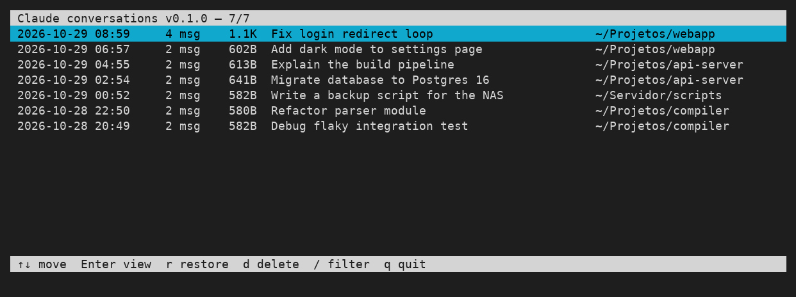
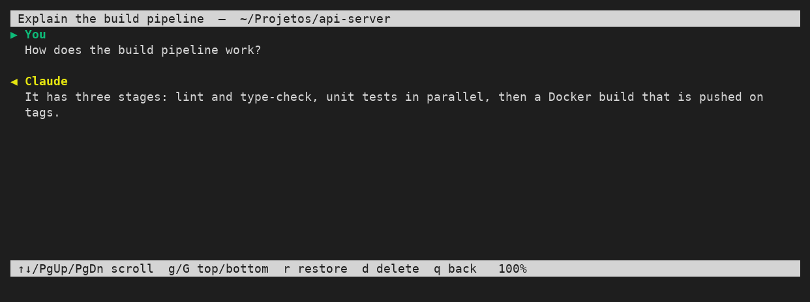

# claude-sessions

Terminal browser for your [Claude Code](https://claude.com/claude-code) conversations. List them, read them, restore one (`claude --resume`) or delete it.

Single Python file, standard library only (curses). No dependencies.





*(Screenshots use sample conversations.)*

## Install

```bash
mkdir -p ~/.local/bin && curl -fsSL https://raw.githubusercontent.com/PericlesSavio/claude-sessions/main/claude-sessions -o ~/.local/bin/claude-sessions && chmod +x ~/.local/bin/claude-sessions
```

Requires Python 3 and `~/.local/bin` in your `PATH`. Optional alias:

```bash
echo 'alias cs="claude-sessions"' >> ~/.bashrc
```

## Usage

```bash
claude-sessions            # open the browser
claude-sessions --version
```

| Key | Action |
|---|---|
| `↑` `↓` / `j` `k`, `PgUp` `PgDn`, `g` `G` | move |
| `Enter` | view the conversation (scrollable, only your and Claude's text) |
| `r` | restore: `cd` to the original folder and run `claude --resume <id>` |
| `d` | delete (asks `[y/N]`) |
| `/` | filter by title, folder or id (`Esc` clears) |
| `q` | quit |

Inside the viewer: `r` restore, `d` delete, `q` back.

## Notes

- Sessions are read from `~/.claude/projects` (or `$CLAUDE_CONFIG_DIR/projects`).
- Delete removes the session `.jsonl` and its same-named folder permanently; there is no trash.

## Version

0.1.0
